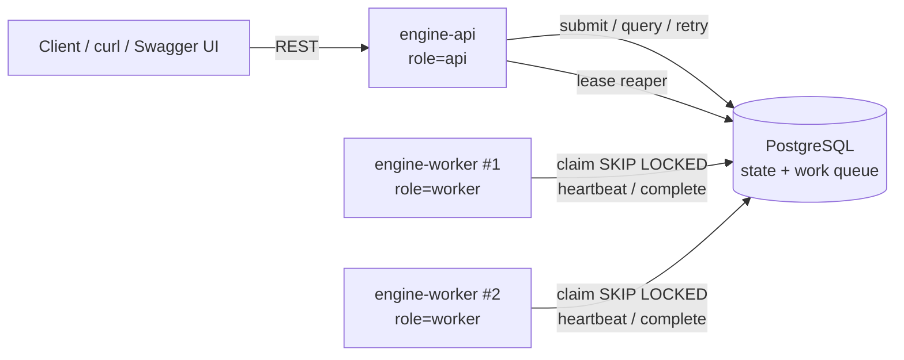

# Plan: Distributed Workflow Engine on PostgreSQL

Plan devised from the requirements, with milestone deliverables and user stories.

## TL;DR

Build a single Spring Boot 3.3 / Java 17 application (one jar, one Docker image, role selected by `ENGINE_ROLE=api|worker|all`). PostgreSQL is both the authoritative state store and the work-coordination mechanism:

- Workers claim ready steps with `SELECT ... FOR UPDATE SKIP LOCKED`.
- A claimed step holds a time-bound **lease**, extended by **heartbeats**.
- Results are committed only if the worker still owns the lease (**fencing** on `lease_owner` + `attempt`).
- A **reaper** recovers steps whose lease expired (crashed / partitioned workers).
- DAG readiness is tracked with a `remaining_deps` counter per step.
- Retries are scheduled via `next_run_at` using exponential backoff with jitter.
- No message broker: Postgres row locking + polling covers all requirements (justified in DESIGN.md).

Delivered in 3 milestones; every milestone ends with a working, locally testable system.

## Technology Stack

| Concern | Choice |
|---|---|
| Language / runtime | Java 17 |
| Framework | Spring Boot 3.3.x (web, validation, actuator) |
| Build | Maven (spring-boot-starter-parent) |
| Database | PostgreSQL 16 |
| Data access | Spring JDBC (`JdbcClient` / `JdbcTemplate`), no JPA |
| Migrations | Flyway |
| API docs | springdoc-openapi 2.x (Swagger UI + OpenAPI 3 spec) |
| Tests | JUnit 5, AssertJ, Spring Boot Test, Testcontainers (PostgreSQL), Awaitility |
| Packaging | Multi-stage Dockerfile, Docker Compose |

## Decisions

- **Single Maven module, single jar.** Role via `ENGINE_ROLE`:
  - `api`: REST API, Swagger UI, Flyway migrations, lease reaper.
  - `worker`: polling worker loop, heartbeat, lease reaper.
  - `all`: everything (local dev, tests).
- **Inline JSON DAG per submission.** No separate workflow-template registry; the submitted definition is stored with the workflow instance. Simplest to implement and test end to end.
- **Built-in simulated step handlers:** `LOG`, `SLEEP`, `HTTP`, `FLAKY`, `TRANSFORM`, `FAIL`.
- **Polling workers** (default 500 ms) instead of LISTEN/NOTIFY.
- **At-least-once step execution.** Handlers receive an idempotency key; this is documented.
- **Downstream steps of a failed step stay `PENDING`** (keeps the status set exactly as specified in the requirements).

## Coding Conventions

- **Comments:** add a one-line comment only where the code cannot explain itself (why, invariants, DB-time or fencing rules, Docker or test prerequisites). Apply to Java, SQL, YAML, and tests. No comments that restate code or describe a change.
- **Changelog:** every completed story gets an entry in [CHANGELOG.md](CHANGELOG.md), newest first.
- **Docs sync:** PLAN, DESIGN, and README (root) are updated whenever behavior or design changes.
- **Verification:** each story ends with `mvn -B verify` green before its changelog entry is written.

## Architecture



### docker-compose services

- `postgres`: postgres:16, named volume for persistence, healthcheck `pg_isready`.
- `engine-api`: built from local Dockerfile (`build: .`), `ENGINE_ROLE=api`, port 8080, runs Flyway, healthcheck on `/actuator/health`, depends_on postgres healthy.
- `engine-worker`: same image, `ENGINE_ROLE=worker`, `deploy.replicas: 2`, Flyway disabled, depends_on engine-api healthy.
- `docker-compose up` (or `docker compose up`) builds and runs everything with no other prerequisite than Docker.

### Package layout (`com.example.workflow`)

| Package | Contents |
|---|---|
| `api` | `WorkflowController`, request/response DTOs, `GlobalExceptionHandler` (ProblemDetail), OpenAPI config |
| `domain` | `WorkflowStatus`, `StepStatus`, `AttemptStatus`, `RetryPolicy`, domain records |
| `dag` | `DagValidator` (structure + Kahn cycle detection) |
| `persistence` | `WorkflowRepository`, `StepRepository`, `AttemptRepository` (Spring JDBC) |
| `engine` | `WorkflowService`, `StepClaimer`, `WorkerLoop`, `StepExecutor`, `LeaseHeartbeat`, `LeaseReaper`, `BackoffPolicy` |
| `handler` | `StepHandler` SPI, `StepContext`, `StepResult`, `HandlerRegistry`, built-in handlers |
| `config` | `EngineProperties` (`@ConfigurationProperties`), role-conditional bean wiring |

## Workflow Definition (API contract)

Each step has a unique identifier, a type/action, input parameters, dependencies, and retry configuration.

```json
{
  "name": "data-pipeline",
  "steps": [
    { "id": "A", "type": "HTTP",      "input": { "url": "http://engine-api:8080/actuator/health" },
      "retry": { "maxAttempts": 3, "initialDelayMs": 500, "multiplier": 2.0, "maxDelayMs": 10000 } },
    { "id": "B", "type": "TRANSFORM", "input": { "op": "uppercase" }, "dependsOn": ["A"] },
    { "id": "C", "type": "FLAKY",     "input": { "failUntilAttempt": 2 }, "dependsOn": ["A"],
      "retry": { "maxAttempts": 4 } },
    { "id": "D", "type": "TRANSFORM", "input": { "op": "merge" }, "dependsOn": ["B", "C"] },
    { "id": "E", "type": "LOG",       "input": { "message": "published" }, "dependsOn": ["D"] }
  ]
}
```

This mirrors the example in the requirements: A (fetch data) → B (process data) and C (validate data) in parallel → D (aggregate results) → E (publish).

- `retry` is optional per step; defaults come from `EngineProperties` (e.g. maxAttempts 3, initial 1000 ms, multiplier 2.0, max 30000 ms).
- Handlers receive upstream outputs keyed by step id, so D can aggregate B and C.

### Built-in step handlers

| Type | Behavior |
|---|---|
| `LOG` | Logs `message`, returns it as output |
| `SLEEP` | Sleeps `durationMs` (interruptible); used for parallelism and crash demos |
| `HTTP` | JDK `HttpClient` GET/POST to `url` with timeout; non-2xx = failure |
| `FLAKY` | Fails while total attempts (across manual retries) < `failUntilAttempt`, then succeeds |
| `TRANSFORM` | Simple data ops on input + upstream outputs (`uppercase`, `merge`, `count`) |
| `FAIL` | Always fails with `message` |

## Data Model (Flyway `V1__init.sql`)

- **workflow**: `id uuid PK`, `name`, `status` (PENDING | RUNNING | COMPLETED | FAILED), `definition jsonb`, `error`, `created_at`, `started_at`, `completed_at`, `updated_at`.
- **step**: `id uuid PK`, `workflow_id FK`, `step_key`, `type`, `input jsonb`, `output jsonb`, `status` (PENDING | RUNNING | COMPLETED | FAILED | RETRYING), `remaining_deps int`, `attempt int`, `max_attempts`, `backoff_initial_ms`, `backoff_multiplier`, `backoff_max_ms`, `next_run_at`, `lease_owner`, `lease_expires_at`, `last_error`, `created_at`, `started_at`, `completed_at`, `updated_at`.
  - `UNIQUE(workflow_id, step_key)`.
  - Partial index on `(next_run_at) WHERE status IN ('PENDING','RETRYING') AND remaining_deps = 0`.
  - Index on `(lease_expires_at) WHERE status = 'RUNNING'` for the reaper.
- **step_dependency**: `workflow_id`, `step_key`, `depends_on_key` (composite PK); index on `(workflow_id, depends_on_key)`.
- **step_attempt** (execution history): `id bigserial`, `step_id FK`, `attempt_no`, `worker_id`, `status` (RUNNING | SUCCEEDED | FAILED | TIMED_OUT), `error`, `started_at`, `finished_at`.

All state lives in Postgres, so workflows survive restarts of any engine container.

## Key Algorithms

1. **Submit** (one transaction): validate DAG (non-empty, unique step ids, dependencies exist, no self-dependency, no cycles via Kahn, known handler type, retry bounds). Insert workflow `PENDING`, steps with `remaining_deps = len(dependsOn)`, dependency rows.
2. **Claim** (worker, one transaction):
   ```sql
   UPDATE step SET status='RUNNING', attempt=attempt+1, lease_owner=:worker,
          lease_expires_at=now()+:lease, started_at=coalesce(started_at, now())
   WHERE id IN (
     SELECT s.id FROM step s JOIN workflow w ON w.id = s.workflow_id
     WHERE s.status IN ('PENDING','RETRYING') AND s.remaining_deps = 0
       AND s.next_run_at <= now() AND w.status IN ('PENDING','RUNNING')
     ORDER BY s.next_run_at LIMIT :freeSlots
     FOR UPDATE OF s SKIP LOCKED)
   RETURNING *;
   ```
   Then set workflow `RUNNING` (if `PENDING`) and insert a `step_attempt` row (`RUNNING`).
3. **Execute**: bounded thread pool; claim only as many steps as there are free threads. Handler gets `StepContext` (input, upstream outputs, attempt number, total attempts, idempotency key `stepId:attempt`).
4. **Heartbeat**: every `lease/3`, extend `lease_expires_at` `WHERE id=? AND lease_owner=? AND attempt=? AND status='RUNNING'`. 0 rows means the lease was lost: interrupt the handler and discard its result.
5. **Complete** (one transaction, fenced): `UPDATE step SET status='COMPLETED', output=? ... WHERE id=? AND lease_owner=? AND attempt=? AND status='RUNNING'`. If 0 rows, discard (stale worker). Otherwise decrement `remaining_deps` of dependents, close the attempt as `SUCCEEDED`, lock the workflow row `FOR UPDATE`, and if no non-`COMPLETED` steps remain, set workflow `COMPLETED`.
6. **Fail** (one transaction, fenced): close the attempt as `FAILED` with error. If `attempt < max_attempts`, set step `RETRYING` with `next_run_at = now + min(maxDelay, initial * multiplier^(attempt-1)) ± 20% jitter`. Otherwise step `FAILED` and workflow `FAILED` with error; the claim query stops picking its remaining steps.
7. **Lease reaper** (every 5 s on each node): `RUNNING` steps with `lease_expires_at < now()` (selected `FOR UPDATE SKIP LOCKED`, so concurrent reapers are safe) get their attempt marked `TIMED_OUT`, then the same retry/fail rule as step 6 applies.
8. **Manual retry**: allowed only when workflow is `FAILED` (conditional update, else 409). Reset `FAILED` steps to `PENDING` with `attempt=0`, `next_run_at=now()`, `last_error=null`; workflow back to `RUNNING`, `error=null`. Attempt history is preserved.

## Failure Handling (Distributed Execution)

| Scenario | Handling |
|---|---|
| Multiple workers compete for the same step | `FOR UPDATE SKIP LOCKED` in the claim query: exactly one worker gets each ready step; others skip it without blocking |
| Worker crashes mid-execution | Heartbeats stop, lease expires, reaper marks the attempt `TIMED_OUT` and re-queues the step (or fails it if retries are exhausted) |
| Network partition between worker and DB | Worker cannot heartbeat, lease expires, and another worker picks the step up. When the partitioned worker reconnects, its fenced completion/failure update matches 0 rows and the result is discarded |
| Worker loses DB connection while committing | Transaction either commits or rolls back. If rolled back, the lease eventually expires and the step is retried (at-least-once) |
| Two parallel steps finish at the same time | Workflow row is locked `FOR UPDATE` during finalization so exactly one transaction marks the workflow `COMPLETED` |
| API/coordinator restarts | No in-memory state; workers keep running. On restart the API serves state from Postgres |
| PostgreSQL restarts | Hikari reconnects; worker loop logs and backs off on errors. Leases that expired during the outage are reaped |
| Step exhausts retries | Step `FAILED`, workflow `FAILED`, dependents never run; manual retry available |
| Duplicate manual retry calls | Conditional update on `status='FAILED'`; the second call gets 409 |

## REST API

| Method | Path | Purpose | Responses |
|---|---|---|---|
| POST | `/api/workflows` | Submit a new workflow (inline JSON DAG) | 201 `{id, status}`, 400 |
| GET | `/api/workflows/{id}` | Workflow status with all steps and attempt history | 200, 404 |
| GET | `/api/workflows/{id}/steps/{stepId}` | Single step status with attempt history | 200, 404 |
| GET | `/api/workflows?status=&page=&size=` | List all workflows (paged, optional status filter) | 200 |
| POST | `/api/workflows/{id}/retry` | Manually retry a failed workflow | 200, 404, 409 |

- Errors use RFC 7807 `ProblemDetail`.
- **Swagger UI** at `http://localhost:8080/swagger-ui.html`, **OpenAPI spec** at `/v3/api-docs`. Every endpoint is executable via "Try it out". Enabled only on `api`/`all` roles (`springdoc.api-docs.enabled=false` and `springdoc.swagger-ui.enabled=false` on the worker profile).

## Milestones and User Stories

### Milestone 1: Foundation and DAG execution (single worker)

Goal: submit a DAG via API, a single worker executes it (sequential and parallel branches), state is queryable, all running via Docker Compose.

- **US1.1 Project scaffold.** As a developer, I want a Spring Boot project skeleton so that features can be built on it.
  - Replace `pom.xml` with spring-boot-starter-parent 3.3.x; dependencies: web, jdbc, validation, actuator, flyway-core, flyway-database-postgresql, postgresql, springdoc-openapi-starter-webmvc-ui; test: spring-boot-starter-test, testcontainers (junit-jupiter, postgresql), awaitility.
  - Add `WorkflowEngineApplication`, `application.yml`, profiles `api`, `worker`, `all`.
  - AC: `mvn verify` passes; app starts with `ENGINE_ROLE=all` against a local Postgres.
- **US1.2 Database schema.** As the engine, I need persistent tables so that state survives restarts.
  - `V1__init.sql` with all tables and indexes from the data model.
  - AC: Testcontainers test boots the context and Flyway migrates cleanly.
- **US1.3 Submit workflow with DAG validation.** As a client, I want to submit a workflow so that it gets executed.
  - DTOs with Bean Validation; `DagValidator`; `WorkflowService.submit` in one transaction.
  - AC: valid DAG returns 201 with id; cycle, missing dependency, duplicate step id, unknown type, invalid retry config each return 400 with a clear message. Unit tests for `DagValidator`.
- **US1.4 Query workflow and step status.** As a client, I want to see the workflow and step status and attempt history.
  - `GET /api/workflows/{id}` and `GET /api/workflows/{id}/steps/{stepId}`.
  - AC: returns workflow status, each step's status/attempt/output/last error, and attempt history; 404 for unknown ids.
- **US1.5 Swagger / OpenAPI.** As a developer, I want interactive API docs so that I can execute APIs from the browser.
  - springdoc config, `@Operation` / `@Schema` on controllers and DTOs, `@ExampleObject` with the A→(B,C)→D→E sample on the submit body, documented error responses.
  - AC: `/swagger-ui.html` "Try it out" can submit and query; `/v3/api-docs` returns 200 (asserted in an API test). Endpoints added in later stories carry the same annotations.
- **US1.6 Step handler SPI.** As a developer, I want pluggable step types so that steps do real (simulated) work.
  - `StepHandler` interface, `HandlerRegistry`, `LOG`, `SLEEP`, `TRANSFORM`, `FAIL` handlers.
  - AC: unit tests per handler; unknown type rejected at submit time.
- **US1.7 Worker execution loop.** As the engine, I want a worker to execute ready steps respecting dependencies.
  - `WorkerLoop` (scheduled poll), `StepClaimer` (SKIP LOCKED claim), `StepExecutor` (thread pool), completion with dependency unlock and workflow finalization.
  - AC: integration test: sequential workflow completes in order; parallel branches B and C both run (overlapping `started_at`/`completed_at` with `SLEEP`); workflow ends `COMPLETED`; step failure with `FAIL` (maxAttempts 1) ends workflow `FAILED`.
- **US1.8 Containerization.** As a developer, I want to run the system with `docker-compose up`.
  - Multi-stage Dockerfile (maven:3-eclipse-temurin-17 → eclipse-temurin:17-jre), `docker-compose.yml` with postgres, engine-api, engine-worker (`deploy.replicas: 2`), healthchecks, `build: .`.
  - AC: `docker-compose up --build`, submit the sample via curl or Swagger UI, it reaches `COMPLETED`.

### Milestone 2: Distributed execution and fault tolerance (depends on M1)

Goal: multiple workers safely share work; crashes, partitions, and transient failures are handled; failed workflows can be retried manually.

- **US2.1 Multi-worker safe claiming.** As an operator, I want to run several workers so that throughput scales.
  - Worker id = hostname + random suffix; compose `deploy.replicas: 2`.
  - AC: concurrency test with N claimer threads over M ready steps shows each step claimed exactly once.
- **US2.2 Leases, heartbeat, and fencing.** As the engine, I want only the current lease owner to commit a step result.
  - `LeaseHeartbeat`, fenced complete/fail updates.
  - AC: test where a lease is stolen (simulated expiry + re-claim) shows the stale worker's completion is rejected and its result discarded.
- **US2.3 Lease reaper.** As the engine, I want steps from crashed or partitioned workers recovered automatically.
  - `LeaseReaper` scheduled every 5 s.
  - AC: expired `RUNNING` step gets a `TIMED_OUT` attempt and is re-queued (or `FAILED` when retries are exhausted).
- **US2.4 Retry with exponential backoff.** As a workflow author, I want configurable max attempts and backoff per step.
  - `BackoffPolicy` (exponential, capped, ±20% jitter), per-step `retry` config with defaults.
  - AC: unit tests for delay calculation; integration test: `FLAKY` step fails twice then succeeds, status passes through `RETRYING`, delays between attempts grow.
- **US2.5 Failure propagation.** As a client, I want the workflow to fail when a step exhausts its retries.
  - AC: step `FAILED` → workflow `FAILED` with error message; dependents never start.
- **US2.6 Manual retry.** As a client, I want to retry a failed workflow.
  - `POST /api/workflows/{id}/retry` with Swagger annotations.
  - AC: `FAILED` → `RUNNING` → `COMPLETED` when the failure was transient; already-completed steps are not re-run; 409 when the workflow is not `FAILED`; attempt history preserved.
- **US2.7 FLAKY and HTTP handlers.** As a demo author, I want realistic transient failures and external calls.
  - `FLAKY` uses total attempts across manual retries; `HTTP` uses JDK `HttpClient` with timeout.
  - AC: unit tests; HTTP failure on non-2xx and timeout.
- Verify: `docker-compose up --build`, submit the crash sample, `docker compose kill` the worker holding the step, other worker finishes it.

### Milestone 3: Usability, samples, end-to-end tests, and documentation (depends on M2)

Goal: complete deliverables: list API, sample workflows, demo script, E2E tests, README.md, DESIGN.md.

- **US3.1 List workflows.** As a client, I want to list all workflows.
  - `GET /api/workflows?status=&page=&size=` with Swagger annotations; ordered by `created_at desc`.
  - AC: pagination and status filter work; invalid status returns 400.
- **US3.2 Sample workflows and demo script.** As an evaluator, I want ready-made samples that demonstrate all capabilities.
  - `samples/sequential.json` (A → B → C).
  - `samples/parallel.json` (A → B, C → D → E, the requirements example, B and C use `SLEEP` to show overlap).
  - `samples/retry.json` (`FLAKY` step recovers after retries with backoff).
  - `samples/failing.json` (exhausts retries → `FAILED`; succeeds after manual retry).
  - `samples/crash.json` (long `SLEEP` for kill-a-worker demo).
  - `scripts/demo.sh` (curl + jq): submits each sample, polls until terminal state, triggers manual retry for `failing.json`, prints a summary.
  - AC: `./scripts/demo.sh` against `docker-compose up` ends with every sample in its expected state.
- **US3.3 Observability.** As an operator, I want to see what the engine is doing.
  - Actuator health/metrics; MDC with `workerId`, `workflowId`, `stepId` in logs; Micrometer counters for claims, completions, failures, retries, reaped leases.
  - AC: counters visible at `/actuator/metrics`.
- **US3.4 Graceful shutdown.** As an operator, I want workers to stop cleanly.
  - Stop claiming on shutdown, let in-flight steps finish within a timeout; anything left is recovered by the reaper.
  - AC: `docker compose stop engine-worker` during a run does not lose steps.
- **US3.5 End-to-end tests.** As a maintainer, I want automated proof that the system works.
  - `@SpringBootTest` + Testcontainers Postgres with 2 in-process worker loops (distinct worker ids) and short lease (2 s).
  - Scenarios: sequential, parallel (overlap asserted), retry with backoff, retries exhausted → `FAILED`, manual retry → `COMPLETED`, crash recovery (stop one worker mid-step → `TIMED_OUT` attempt → completed by other worker), restart persistence (new context resumes a `RUNNING` workflow).
  - AC: `mvn verify` green.
- **US3.6 README.md and DESIGN.md.**
  - README.md: Quick Start (build and run locally, `docker-compose up`), Architecture Overview with mermaid diagram, Example Usage (curl and Swagger UI to submit and monitor workflows), Testing Instructions (`mvn verify`, demo script, crash demo).
  - DESIGN.md:
    - Architecture Decisions (Postgres as queue, SKIP LOCKED, leases + fencing, single jar with roles, Spring JDBC over JPA, polling).
    - Alternatives Considered (Kafka/RabbitMQ, Temporal/Camunda, LISTEN/NOTIFY, advisory locks, central scheduler pushing work, JPA optimistic locking).
    - Tradeoffs (simplicity and correctness over throughput and latency; at-least-once over exactly-once).
    - Failure Modes (table above).
    - Scalability Considerations (current limits: polling load, single Postgres, hot index; scaling: more workers, LISTEN/NOTIFY, partitioning, read replicas for queries, archiving completed workflows).
    - Future Improvements, prioritized (cancel/pause, LISTEN/NOTIFY wakeups, per-step timeouts, workflow templates/versioning, auth, UI, data retention, sub-workflows).

## Requirements Traceability

| Requirement | Covered by |
|---|---|
| DAG workflows, sequential and parallel steps | US1.3, US1.7, samples |
| Step: id, type, input, dependencies, retry config | Workflow definition contract, US1.3 |
| Persist state across restarts | US1.2, US3.5 restart scenario |
| Workflow lifecycle PENDING / RUNNING / COMPLETED / FAILED | Data model, algorithms 1, 2, 5, 6 |
| Step states PENDING / RUNNING / COMPLETED / FAILED / RETRYING | Data model, algorithms 2, 5, 6 |
| Step execution history (attempts, timestamps, errors) | `step_attempt`, US1.4 |
| Query workflow and step status via API | US1.4 |
| Multiple workers executing concurrently | US2.1 |
| Workers competing for the same step | SKIP LOCKED claim, US2.1 |
| Worker crash mid-execution | Leases + reaper, US2.3, US3.5 |
| Network partitions | Leases + fencing, US2.2 |
| Configurable max retries and exponential backoff | US2.4 |
| Workflow fails when a step exhausts retries | US2.5 |
| Manual retry of failed workflows | US2.6 |
| docker-compose with engine, workers, database | US1.8, US2.1 |
| Runnable with `docker-compose up` | US1.8 |
| Sample workflows demonstrating all capabilities | US3.2 |
| API: submit, query, list, retry | US1.3, US1.4, US3.1, US2.6 |
| Swagger / OpenAPI | US1.5 |
| README.md content | US3.6 |
| DESIGN.md content | US3.6 |
| Tests (JUnit 5, Testcontainers) | Every story's AC, US3.5 |

## Verification

1. `mvn verify`: unit tests (`DagValidator`, `BackoffPolicy`, handlers) plus Testcontainers integration and E2E tests (requires Docker).
2. `docker-compose up --build -d`, then `./scripts/demo.sh`: all samples reach their expected terminal states.
3. Swagger UI at `http://localhost:8080/swagger-ui.html`: submit each `samples/*.json` via "Try it out", poll status by id, query a single step, list with a status filter, retry a `FAILED` workflow.
4. Crash demo: submit `crash.json`, find the worker holding the step (`worker_id` in attempt history), `docker compose kill` that container, observe a `TIMED_OUT` attempt followed by `COMPLETED` on the other worker.
5. Restart demo: `docker compose restart` mid-run; state persists and workflows resume.

## Scope

- **Included:** everything in the requirements, single jar with roles, polling workers, Swagger UI and OpenAPI spec.
- **Excluded (listed as future improvements in DESIGN.md):** message broker, authentication, UI, workflow templates/versioning, cancel/pause, LISTEN/NOTIFY wakeups, per-step timeouts beyond leases, sub-workflows, data retention/archiving.

## Configuration Defaults

| Property | Default | Notes |
|---|---|---|
| `ENGINE_ROLE` (env) | `all` | `api`, `worker`, or `all`; selects the Spring profile |
| `engine.worker.enabled` | `true` | |
| `engine.worker.poll-interval-ms` | `500` | `@Scheduled` placeholder in `WorkerLoop` |
| `engine.worker.threads` | `4` | max concurrent steps per worker |
| `engine.worker.lease` | `30s` | tests use `2s` |
| `engine.worker.shutdown-timeout` | `20s` | in-flight steps drain within this window |
| Heartbeat interval | `lease / 3` | derived, not a property |
| Reaper interval | `5s` | fixed in `LeaseReaper`, not configurable |
| `engine.retry.default-max-attempts` | `3` | |
| `engine.retry.default-initial-delay` | `1s` | |
| `engine.retry.default-multiplier` | `2.0` | |
| `engine.retry.default-max-delay` | `30s` | |
