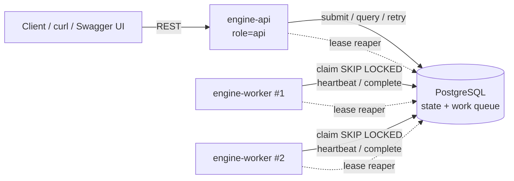
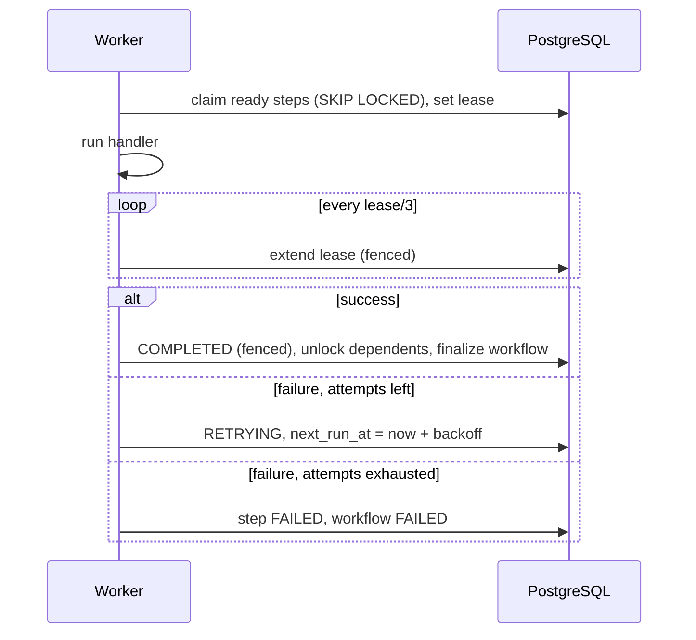

# Distributed Workflow Engine

> **Quick demo:** `docker-compose up -d --build && ./scripts/demo.sh` runs all sample workflows to completion. Details in [Demo script](#demo-script).

A distributed workflow engine that runs multi-step workflows defined as Directed Acyclic Graphs (DAGs). It persists state, controls concurrency, and tolerates faults. PostgreSQL is both the authoritative state store and the work-coordination mechanism; there is no message broker.

- Java 17, Spring Boot 3.3, Maven
- PostgreSQL 16, Spring JDBC, Flyway
- Docker and Docker Compose
- JUnit 5, Testcontainers

## Quick Start

### Prerequisites

- Docker with Docker Compose
- For building and testing outside Docker: JDK 17 and Maven 3.9+
- For the demo script: `curl` and `jq`

Check your versions:

```bash
docker --version && docker compose version
java -version      # 17 or newer
mvn -version       # 3.9 or newer
curl --version | head -1 && jq --version
```

First-time setup needs internet access to pull Docker images and Maven dependencies. After that, the stack can run offline.

### Run with Docker Compose

From the repository root (`docker compose` and `docker-compose` are the same command for this guide):

```bash
docker-compose up --build
```

This starts:

| Service | Role | Port |
|---|---|---|
| `postgres` | State store and work queue | 5432 |
| `engine-api` | REST API, Swagger UI, Flyway migrations, lease reaper | 8080 |
| `engine-worker` (×2) | Claims and executes steps, heartbeats, lease reaper | – |

Wait until `engine-api` reports healthy:

```bash
curl -s http://localhost:8080/actuator/health
# {"status":"UP"}
```

- Swagger UI: http://localhost:8080/swagger-ui.html
- OpenAPI spec: http://localhost:8080/v3/api-docs

Stop everything (add `-v` to also delete the database volume):

```bash
docker-compose down
```

### Build and run locally without Docker for the app

```bash
docker-compose up -d postgres
mvn clean package
ENGINE_ROLE=all java -jar target/workflow-engine.jar
```

`ENGINE_ROLE=all` runs the API and a worker in one process. The role is read from the environment variable because it selects the Spring profile.

### Configuration

| Property / env var | Default | Description |
|---|---|---|
| `ENGINE_ROLE` | `all` | `api`, `worker`, or `all`; selects the Spring profile |
| `engine.worker.enabled` | `true` | Whether this process runs a worker loop |
| `engine.worker.poll-interval-ms` | `500` | How often a worker polls for ready steps |
| `engine.worker.threads` | `4` | Max concurrent steps per worker |
| `engine.worker.lease` | `30s` | Step lease length; heartbeat renews every lease/3 |
| `engine.worker.shutdown-timeout` | `20s` | Drain time for in-flight steps on shutdown |
| `engine.retry.default-max-attempts` | `3` | Default per-step max attempts |
| `engine.retry.default-initial-delay` | `1s` | Default first backoff delay |
| `engine.retry.default-multiplier` | `2.0` | Default backoff multiplier |
| `engine.retry.default-max-delay` | `30s` | Backoff cap |
| `SPRING_DATASOURCE_URL` | `jdbc:postgresql://localhost:5432/workflow` | Database URL |

Scale workers:

```bash
docker-compose up -d --scale engine-worker=4
```

## Architecture Overview



- **One jar, one image, three roles.** `ENGINE_ROLE` decides whether a process serves the API, runs a worker, or both.
- **PostgreSQL holds all state.** No component keeps workflow state in memory, so any container can restart without losing work.
- **Claiming work.** Workers poll for ready steps and claim them atomically with `SELECT ... FOR UPDATE SKIP LOCKED`, so each step is claimed by exactly one worker.
- **Leases.** A claimed step carries a time-bound lease that the worker extends with heartbeats. If the worker crashes or is partitioned, the lease expires and a reaper re-queues the step.
- **Fencing.** A worker can commit a result only if it still owns the lease (`lease_owner` + `attempt`). Late results from stale workers are discarded.
- **DAG readiness.** Each step tracks `remaining_deps`. Completing a step decrements its dependents in the same transaction; a step is ready at zero.
- **Retries.** Failed attempts are rescheduled through `next_run_at` with exponential backoff and jitter. When attempts are exhausted, the step and the workflow become `FAILED`.

### Step execution lifecycle



### States

| Entity | States |
|---|---|
| Workflow | `PENDING` → `RUNNING` → `COMPLETED` \| `FAILED` (`FAILED` → `RUNNING` on manual retry) |
| Step | `PENDING` → `RUNNING` → `COMPLETED` \| `RETRYING` → `RUNNING` … \| `FAILED` |
| Attempt (history) | `RUNNING` → `SUCCEEDED` \| `FAILED` \| `TIMED_OUT` |

### Project layout

```
src/main/java/com/example/workflow/
  api/          REST controllers, DTOs, error handling, OpenAPI config
  domain/       Status enums, retry policy, domain records
  dag/          DAG validation (cycle detection)
  persistence/  Spring JDBC repositories
  engine/       Submit, claim, execute, heartbeat, reaper, backoff
  handler/      StepHandler SPI and built-in handlers
  config/       EngineProperties and role-based wiring
src/main/resources/db/migration/   Flyway migrations
samples/                           Sample workflow definitions
scripts/demo.sh                    End-to-end demo script
```

## Example Usage

### Workflow definition

Each step has a unique `id`, a `type`, `input` parameters, `dependsOn`, and optional `retry` configuration (defaults apply when omitted).

```json
{
  "name": "data-pipeline",
  "steps": [
    { "id": "A", "type": "HTTP", "input": { "url": "http://engine-api:8080/actuator/health" },
      "retry": { "maxAttempts": 3, "initialDelayMs": 500, "multiplier": 2.0, "maxDelayMs": 10000 } },
    { "id": "B", "type": "TRANSFORM", "input": { "op": "uppercase" }, "dependsOn": ["A"] },
    { "id": "C", "type": "FLAKY", "input": { "failUntilAttempt": 2 }, "dependsOn": ["A"],
      "retry": { "maxAttempts": 4 } },
    { "id": "D", "type": "TRANSFORM", "input": { "op": "merge" }, "dependsOn": ["B", "C"] },
    { "id": "E", "type": "LOG", "input": { "message": "published" }, "dependsOn": ["D"] }
  ]
}
```

A (fetch) runs first; B (process) and C (validate) run in parallel; D (aggregate) waits for both; E (publish) runs last.

### Built-in step types

| Type | Input | Behavior |
|---|---|---|
| `LOG` | `message` | Logs and returns the message |
| `SLEEP` | `durationMs` | Sleeps (used to show parallelism and crash recovery) |
| `HTTP` | `url`, `method`, `timeoutMs` | Calls a URL; non-2xx or timeout fails the attempt |
| `FLAKY` | `failUntilAttempt` | Fails until the total attempt count (including manual retries) reaches the value |
| `TRANSFORM` | `op` (`uppercase`, `merge`, `count`) | Transforms input and upstream outputs |
| `FAIL` | `message` | Always fails |

### Submit a workflow

```bash
curl -s -X POST http://localhost:8080/api/workflows \
  -H 'Content-Type: application/json' \
  -d @samples/parallel.json
# {"id":"6f1c...","status":"PENDING"}
```

### Monitor a workflow

```bash
curl -s http://localhost:8080/api/workflows/6f1c... | jq
```

```json
{
  "id": "6f1c...",
  "name": "data-pipeline",
  "status": "RUNNING",
  "createdAt": "2026-10-22T10:00:00Z",
  "steps": [
    { "stepId": "A", "type": "HTTP", "status": "COMPLETED", "attempt": 1,
      "attempts": [ { "attemptNo": 1, "workerId": "252ca39648ab-11d64ecd", "status": "SUCCEEDED",
                      "startedAt": "...", "finishedAt": "..." } ] },
    { "stepId": "C", "type": "FLAKY", "status": "RETRYING", "attempt": 1, "nextRunAt": "...",
      "lastError": "Simulated failure (attempt 1 < 2)" }
  ]
}
```

Single step:

```bash
curl -s http://localhost:8080/api/workflows/6f1c.../steps/C | jq
```

### List workflows

```bash
curl -s 'http://localhost:8080/api/workflows?status=FAILED&page=0&size=20' | jq
```

The response is a page object with `content`, `page`, `size`, and `totalElements`.

### Retry a failed workflow

```bash
curl -s -X POST http://localhost:8080/api/workflows/6f1c.../retry
# 200 with the updated workflow; 409 Conflict if the workflow is not FAILED
```

### API reference

| Method | Path | Purpose |
|---|---|---|
| POST | `/api/workflows` | Submit a workflow |
| GET | `/api/workflows/{id}` | Workflow status, steps, attempt history |
| GET | `/api/workflows/{id}/steps/{stepId}` | Single step status and attempts |
| GET | `/api/workflows?status=&page=&size=` | List workflows |
| POST | `/api/workflows/{id}/retry` | Retry a failed workflow |

Errors use RFC 7807 problem details (`400` invalid definition, `404` not found, `409` invalid state). All endpoints can be executed from Swagger UI via "Try it out".

### Sample workflows

| File | Demonstrates | Expected result |
|---|---|---|
| [sequential.json](samples/sequential.json) | Sequential execution A → B → C | `COMPLETED` |
| [parallel.json](samples/parallel.json) | Parallel execution A → (B, C) → D → E; B and C sleep 3 s each | `COMPLETED`, B and C overlap in time (~4 s total, not ~7 s) |
| [retry.json](samples/retry.json) | `FLAKY` step fails twice, succeeds on attempt 3 (backoff 1 s, 2 s) | `COMPLETED` after `RETRYING` attempts |
| [failing.json](samples/failing.json) | `FLAKY` step needs 4 attempts but allows 3 | `FAILED`; after manual retry, attempt 4 succeeds → `COMPLETED` |
| [crash.json](samples/crash.json) | 20 s `SLEEP` step; kill its worker mid-run | `TIMED_OUT` attempt, then `COMPLETED` on another worker |

## Testing Instructions

### Automated tests

Requires Docker (Testcontainers starts PostgreSQL):

```bash
mvn verify
```

| Level | Covers |
|---|---|
| Unit | DAG validation (cycles, missing/duplicate ids, unknown types), backoff calculation, step handlers |
| Integration (Testcontainers) | Concurrent claiming (each step claimed exactly once), lease fencing rejects stale workers, lease reaper recovery, retry and backoff, failure propagation, manual retry, API and OpenAPI endpoints |
| End-to-end | Two in-process workers: sequential, parallel, retry, failure, manual retry, crash recovery, restart persistence |

### Demo script

Runs every sample against the running stack and prints a summary.

Prerequisites, in order:

1. Docker Desktop is running.
2. Start the stack from the repository root: `docker compose up --build -d`. Wait until `docker compose ps` shows `engine-api` as healthy.
3. Run the demo script:

```bash
./scripts/demo.sh
```

4. Stop the stack when finished: `docker compose down` (add `-v` to also delete the database volume).

If you get `permission denied` (for example, after downloading a ZIP instead of cloning), run `chmod +x scripts/demo.sh` once, or run `bash scripts/demo.sh`.

The script submits every sample, polls them in a live status table until each reaches a terminal state (`COMPLETED` or `FAILED`), retries `failing.json` once, and prints a summary. Expected result: every sample ends `COMPLETED`.

| Option | Effect |
|---|---|
| `--quick` | Skips `crash.json` (the slowest sample), so the run is shorter |
| `--no-color` | Plain text output without colours or the live table; also set by the `NO_COLOR` env var |
| `-h`, `--help` | Prints usage |

```bash
./scripts/demo.sh --quick
./scripts/demo.sh --no-color
```

### Manual verification with Swagger UI

1. Open http://localhost:8080/swagger-ui.html.
2. `POST /api/workflows` → "Try it out" → paste a file from `samples/` → Execute.
3. `GET /api/workflows/{id}` with the returned id until the status is terminal.

### Crash demo

Shows lease recovery after a worker dies mid-step. Expected result: attempt 1 is `TIMED_OUT`, attempt 2 runs on the surviving worker, and the workflow is `COMPLETED`.

1. Submit `samples/crash.json` (a 20 s `SLEEP` step `A`, then step `B`):

```bash
curl -s -X POST http://localhost:8080/api/workflows -H 'Content-Type: application/json' -d @samples/crash.json
```

2. Find the worker running step `A`. The `workerId` in the attempt history shows it. Worker IDs start with the container hostname, which is the short container ID by default:

```bash
curl -s http://localhost:8080/api/workflows/<id> | jq '.steps[] | select(.stepId=="A") | .attempts[] | {attemptNo, workerId, status}'
docker ps --filter name=engine-worker
```

3. Kill that container while `A` is running. Use `kill`, not `stop`: `stop` drains in-flight steps and does not simulate a crash.

```bash
docker kill <container-id>
```

4. Wait for the lease to expire (`engine.worker.lease`, 30 s by default; the reaper checks every 5 s). Attempt 1 becomes `TIMED_OUT`, the surviving worker re-runs `A` as attempt 2, and then `B` runs.
5. Confirm the result:

```bash
curl -s http://localhost:8080/api/workflows/<id> | jq .status   # "COMPLETED"
```

For graceful shutdown instead, use `docker compose stop engine-worker`. The worker drains in-flight steps within `engine.worker.shutdown-timeout` (20 s).

### Restart persistence

```bash
curl -s -X POST http://localhost:8080/api/workflows -H 'Content-Type: application/json' -d @samples/parallel.json
docker-compose restart
curl -s http://localhost:8080/api/workflows/<id> | jq .status   # resumes and reaches COMPLETED
```

### Observability

- Health: `GET /actuator/health`
- Metrics: `GET /actuator/metrics/workflow.steps.claimed` (also `completed`, `failed`, `retried`, `reaped`)
- Logs: every line includes `workerId`, `workflowId`, and `stepId` where applicable

```bash
docker-compose logs -f engine-worker
```

## Troubleshooting

| Symptom | Cause and fix |
|---|---|
| `curl` to `localhost:8080` is refused | `engine-api` is not running or still starting. Run `docker compose ps` and `docker compose logs engine-api`. |
| `engine-api` never becomes healthy | PostgreSQL is not ready or a Flyway migration failed. Run `docker compose logs postgres engine-api`. |
| Port 8080 or 5432 is already in use | Stop the other process, or change the host port in `docker-compose.yml`. |
| `permission denied: ./scripts/demo.sh` | Run `chmod +x scripts/demo.sh`, or run `bash scripts/demo.sh`. |
| `demo.sh` reports `jq: command not found` | Install `jq` (on macOS: `brew install jq`). |
| Submit returns 400 | The workflow definition is invalid: cycle, missing dependency, duplicate step id, unknown type, or invalid retry config. The response message names the problem. |
| Retry returns 409 | Only `FAILED` workflows can be retried. Check the status with `GET /api/workflows/{id}`. |
| `mvn verify` fails with Docker errors | Testcontainers needs a running Docker daemon. Start Docker Desktop. |
